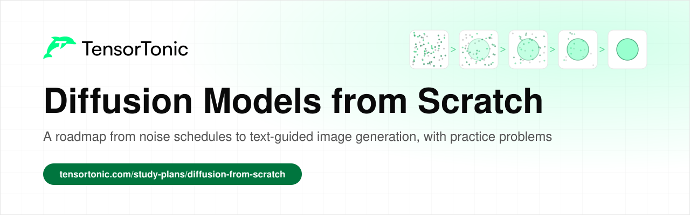
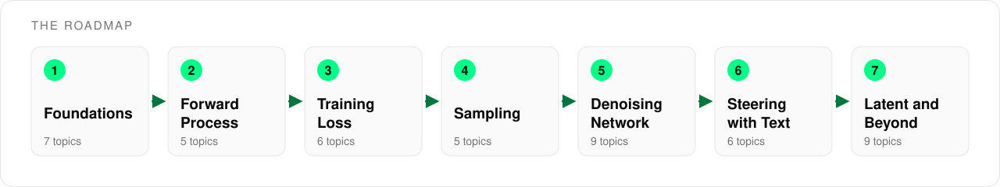

# Diffusion Models from Scratch

  

This is a roadmap for learning how diffusion models turn random noise into images. It covers 47 topics across seven stages, from the noise schedule and the training loss to text guidance and latent diffusion.

Every topic links to an explanation and to practice problems where you implement the idea in Python and check your code against tests. The forward process, the training loss and the sampling loop in stages 2 to 4 are the core of a diffusion model, and the other stages cover the pieces those three depend on.

## Table of Contents

- [Who this is for](#who-this-is-for)
- [How to use this roadmap](#how-to-use-this-roadmap)
- [Stage 1: Foundations](#stage-1-foundations)
- [Stage 2: The Forward Process](#stage-2-the-forward-process)
- [Stage 3: The Training Loss](#stage-3-the-training-loss)
- [Stage 4: Sampling](#stage-4-sampling)
- [Stage 5: The Denoising Network](#stage-5-the-denoising-network)
- [Stage 6: Steering with Text](#stage-6-steering-with-text)
- [Stage 7: Latent Diffusion and Beyond](#stage-7-latent-diffusion-and-beyond)
- [What's next](#whats-next)

## Who this is for

This roadmap is for anyone who wants to understand how image generators work by building each part themselves.

- If you are a **student**, go through the stages in order and do at least one problem per topic.
- If you are **preparing for interviews**, stages 2 to 4 cover the diffusion questions that come up most often.
- If you already **work in ML**, use the tables as a checklist and go straight to the samplers, guidance and flow matching topics.

You need basic Python, some probability, and a rough idea of how gradient descent and convolutions work. Stage 1 covers the parts that matter here if you need a refresher.

## How to use this roadmap

Each stage builds on the ones before it. The forward process defines what the network learns to undo, the training loss depends on the noise schedule, and the sampling loop reuses both.

For each topic, read the explanation first, then solve one or two of the practice problems. The [Diffusion Models from Scratch](https://www.tensortonic.com/study-plans/diffusion-from-scratch) study plan groups most of these problems into lessons in the same order. Topics without a practice link are worth reading because later topics depend on them.

## Stage 1: Foundations

Diffusion runs on Gaussian noise, so you need to be comfortable sampling it and comparing two Gaussians. The model is trained with a plain regression loss and an adaptive optimizer, and most of the network is convolutions.

| Topic | Read | Practice |
| --- | --- | --- |
| Gaussian noise and sampling | [Probability distributions](https://www.tensortonic.com/ml-math/probability/distributions) | [Reparameterized Gaussian Sample](https://www.tensortonic.com/problems/diffusion-l01-reparameterized-gaussian-sample), [z-Score Standardization](https://www.tensortonic.com/problems/zscore-standardization) |
| KL divergence between Gaussians | [What is KL divergence?](https://www.tensortonic.com/ml-math/information-theory/kl-divergence) | [Diagonal Gaussian KL Divergence](https://www.tensortonic.com/problems/diffusion-l01-diagonal-gaussian-kl) |
| The score of a distribution | [Partial derivatives and gradients](https://www.tensortonic.com/ml-math/calculus/partial-derivatives) | [Gaussian Mixture Score](https://www.tensortonic.com/problems/diffusion-l01-gaussian-mixture-score) |
| Mean squared error | [Which loss function to use](https://www.tensortonic.com/guides/which-loss-function-to-use) | [Mean Squared Error (MSE)](https://www.tensortonic.com/problems/mean-squared-error) |
| Adam and AdamW | [Adam vs RMSprop vs AdaGrad](https://www.tensortonic.com/ml-math/optimization/adaptive-rates), [Which optimizer to use](https://www.tensortonic.com/guides/which-optimizer-to-use) | [Adam Optimizer Step](https://www.tensortonic.com/problems/adam-optimizer), [AdamW (Decoupled Weight Decay)](https://www.tensortonic.com/problems/adamw-optimizer) |
| Convolutions | | [2D Convolution (Image Filtering)](https://www.tensortonic.com/problems/conv2d-image-filtering), [Multichannel 2D Convolution](https://www.tensortonic.com/problems/cv-conv2d-multichannel) |
| Transposed convolutions | | [2D Transposed Convolution](https://www.tensortonic.com/problems/cv-conv2d-transpose) |

## Stage 2: The Forward Process

The forward process takes a clean image and adds a little Gaussian noise at each of many steps until only static is left. The noise schedule decides how much noise goes in at each step. Because the noise is Gaussian, you can jump straight from the clean image to any step without looping.

| Topic | Read | Practice |
| --- | --- | --- |
| The forward process as a Markov chain | [Markov chains](https://www.tensortonic.com/ml-math/probability/markov-chains) | |
| Linear noise schedule | [DDPM noise schedule](https://www.tensortonic.com/research/ddpm/ddpm-schedule) | [Linear Beta Schedule](https://www.tensortonic.com/problems/diffusion-l02-linear-beta-schedule) |
| Cosine noise schedule | | [Cosine Noise Schedule](https://www.tensortonic.com/problems/diffusion-l02-cosine-noise-schedule) |
| Jumping to any timestep | [DDPM forward diffusion](https://www.tensortonic.com/research/ddpm/ddpm-forward) | [Forward Diffusion Sample](https://www.tensortonic.com/problems/diffusion-l02-forward-diffusion-sample) |
| Signal-to-noise ratio | | [Rescale to Zero Terminal SNR](https://www.tensortonic.com/problems/diffusion-l02-zero-terminal-snr-rescale) |

## Stage 3: The Training Loss

Training picks a random step, adds that much noise to an image, and asks the network to predict the noise that was added. The loss is the mean squared error between that prediction and the real noise. The topics after the basic loss cover what else the network can predict and how to weight the loss across steps.

| Topic | Read | Practice |
| --- | --- | --- |
| Noise prediction loss | [DDPM training loss](https://www.tensortonic.com/research/ddpm/ddpm-loss) | [Noise Prediction Loss](https://www.tensortonic.com/problems/diffusion-l04-noise-prediction-loss) |
| Posterior mean and variance | | [Posterior Mean and Variance](https://www.tensortonic.com/problems/diffusion-l04-posterior-mean-variance) |
| What the network predicts | | [Prediction Parameterization](https://www.tensortonic.com/problems/diffusion-l04-prediction-parameterization) |
| Weighting the loss across timesteps | | [Min-SNR Loss Weighting](https://www.tensortonic.com/problems/diffusion-l04-min-snr-loss-weighting) |
| One training step | [Why training loss is not decreasing](https://www.tensortonic.com/guides/training-loss-not-decreasing) | [Toy Diffusion Training Step](https://www.tensortonic.com/problems/diffusion-l07-toy-diffusion-training-step) |
| Gradient clipping | [Backpropagation](https://www.tensortonic.com/ml-math/calculus/backpropagation) | [Gradient Clipping (Global Norm)](https://www.tensortonic.com/problems/gradient-clipping) |

## Stage 4: Sampling

To generate an image, you start from pure noise and run the process backwards. At each step the network predicts the noise in the current image, a part of it is removed, and a little fresh noise is added back. Each step is a full pass through the network, so faster samplers that use fewer steps matter a lot in practice.

| Topic | Read | Practice |
| --- | --- | --- |
| One reverse step | [DDPM reverse diffusion](https://www.tensortonic.com/research/ddpm/ddpm-reverse) | [DDPM Ancestral Step](https://www.tensortonic.com/problems/diffusion-l05-ddpm-ancestral-step) |
| The full sampling loop | [DDPM sampling](https://www.tensortonic.com/research/ddpm/ddpm-sampling) | [Toy DDPM Sampler](https://www.tensortonic.com/problems/diffusion-l07-toy-ddpm-sampler) |
| Faster sampling with DDIM | | [DDIM Step](https://www.tensortonic.com/problems/diffusion-l05-ddim-step) |
| ODE samplers | | [Karras Euler Sampler](https://www.tensortonic.com/problems/diffusion-l05-karras-euler-sampler) |
| Langevin dynamics | [Monte Carlo methods](https://www.tensortonic.com/ml-math/probability/monte-carlo) | [Annealed Langevin Dynamics](https://www.tensortonic.com/problems/diffusion-l06-annealed-langevin-dynamics) |

## Stage 5: The Denoising Network

The network that predicts the noise is usually a U-Net. Its encoder shrinks the image, its decoder grows it back, and skip connections carry fine detail across. Diffusion adds a timestep embedding so the network knows how noisy its input is, and attention layers so distant parts of the image can affect each other.

| Topic | Read | Practice |
| --- | --- | --- |
| U-Net encoder | [U-Net encoder block](https://www.tensortonic.com/research/unet/unet-encoder-block) | |
| U-Net bottleneck and decoder | [U-Net bottleneck](https://www.tensortonic.com/research/unet/unet-bottleneck), [U-Net decoder block](https://www.tensortonic.com/research/unet/unet-decoder-block) | |
| Skip connections | [U-Net skip connection](https://www.tensortonic.com/research/unet/unet-skip-connection) | [U-Net Skip Connection](https://www.tensortonic.com/problems/dl-unet) |
| Residual blocks | [ResNet skip connection](https://www.tensortonic.com/research/resnet/resnet-skip-connection), [ResNet identity block](https://www.tensortonic.com/research/resnet/resnet-identity-block) | [ResNet Residual Block](https://www.tensortonic.com/problems/dl-resnet-block) |
| Timestep embedding | [Transformer positional encoding](https://www.tensortonic.com/research/transformer/transformers-positional-encoding) | [Sinusoidal Timestep Embedding](https://www.tensortonic.com/problems/diffusion-l03-sinusoidal-timestep-embedding) |
| Time-conditioned residual block | | [Time-Conditioned Residual Block](https://www.tensortonic.com/problems/diffusion-l03-time-conditioned-residual-block) |
| Normalization layers | [Batch norm vs layer norm](https://www.tensortonic.com/ml-math/optimization/batch-normalization) | [Batch Normalization](https://www.tensortonic.com/problems/dl-batch-normalization) |
| Self-attention over image features | [Attention in LLMs](https://www.tensortonic.com/llm-internals/attention-mechanism) | [Spatial Self-Attention Block](https://www.tensortonic.com/problems/diffusion-l03-spatial-self-attention) |
| The full U-Net | [U-Net output layer](https://www.tensortonic.com/research/unet/unet-output-layer), [Full U-Net](https://www.tensortonic.com/research/unet/unet-full-network) | [Tiny U-Net Forward Pass](https://www.tensortonic.com/problems/diffusion-l03-tiny-unet-forward) |

## Stage 6: Steering with Text

A text encoder turns the prompt into embeddings, and the U-Net reads them through cross-attention at every step. CLIP-style training puts text and images in the same embedding space. Classifier-free guidance then runs the network with and without the prompt and pushes the result toward the prompted version.

| Topic | Read | Practice |
| --- | --- | --- |
| Tokenizing the prompt | [Transformer tokenization](https://www.tensortonic.com/research/transformer/transformers-tokenization), [Transformer embedding layer](https://www.tensortonic.com/research/transformer/transformers-embedding) | [Train a BPE Tokenizer From Scratch](https://www.tensortonic.com/problems/cs336-l01-train-byte-pair-encoding) |
| The text encoder | [Transformer attention](https://www.tensortonic.com/research/transformer/transformers-attention), [Transformer encoder block](https://www.tensortonic.com/research/transformer/transformers-encoder-block) | [Scaled Dot-Product Attention](https://www.tensortonic.com/problems/dl-scaled-dot-product-attention), [Multi-Head Attention](https://www.tensortonic.com/problems/dl-multi-head-attention) |
| Cross-attention | [Transformer multi-head attention](https://www.tensortonic.com/research/transformer/transformers-multi-head-attention) | |
| CLIP | [Train a Tiny CLIP from Scratch](https://www.tensortonic.com/projects/tiny-clip-from-scratch) | [Symmetric CLIP Contrastive Loss](https://www.tensortonic.com/problems/cs336-l17-symmetric-clip-loss), [CLIP Cosine Retrieval](https://www.tensortonic.com/problems/cv-clip-cosine-retrieval) |
| Contrastive losses | | [InfoNCE Loss](https://www.tensortonic.com/problems/info-nce-loss), [SigLIP Pairwise Loss](https://www.tensortonic.com/problems/cs336-l17-siglip-pairwise-loss) |
| Classifier-free guidance | | [Classifier-Free Guidance](https://www.tensortonic.com/problems/diffusion-l05-classifier-free-guidance) |

## Stage 7: Latent Diffusion and Beyond

Running diffusion on full-size pixels is expensive, so latent diffusion first compresses the image with an autoencoder and runs the diffusion on the small latent. Newer models replace the U-Net with a Transformer over latent patches, and score matching and flow matching give other ways to train the same kind of model. GANs and image quality metrics round out the stage.

| Topic | Read | Practice |
| --- | --- | --- |
| Autoencoders | | [Autoencoder Forward Pass](https://www.tensortonic.com/problems/dl-autoencoder) |
| VAE encoder and reparameterization | [VAE encoder](https://www.tensortonic.com/research/vae/vae-encoder), [VAE reparameterization](https://www.tensortonic.com/research/vae/vae-reparameterization) | [Variational Autoencoder Forward Pass](https://www.tensortonic.com/problems/dl-vae) |
| The ELBO loss | [VAE KL divergence](https://www.tensortonic.com/research/vae/vae-kl-divergence), [VAE ELBO loss](https://www.tensortonic.com/research/vae/vae-elbo-loss) | |
| Diffusion Transformers | | [DiT Patchify and adaLN-Zero Block](https://www.tensortonic.com/problems/diffusion-l07-dit-patchify-adaln-zero), [Patchify a Batch of Images](https://www.tensortonic.com/problems/cs336-l17-vision-transformer-patchify) |
| Score matching | | [Denoising Score Matching Loss](https://www.tensortonic.com/problems/diffusion-l06-denoising-score-matching-loss) |
| Flow matching | | [Conditional Flow Matching Loss](https://www.tensortonic.com/problems/diffusion-l06-conditional-flow-matching-loss) |
| GANs | [GAN generator](https://www.tensortonic.com/research/gan/gan-generator), [GAN loss](https://www.tensortonic.com/research/gan/gan-loss) | [GAN Training Step](https://www.tensortonic.com/problems/dl-gan-training) |
| Mode collapse | [GAN mode collapse](https://www.tensortonic.com/research/gan/gan-mode-collapse), [Jensen-Shannon divergence](https://www.tensortonic.com/ml-math/information-theory/jensen-shannon) | |
| Evaluating generated images | | [Frechet Distance Between Feature Sets](https://www.tensortonic.com/problems/diffusion-l07-frechet-distance) |

## What's next

Once the pieces above feel familiar, the [Diffusion Models from Scratch](https://www.tensortonic.com/study-plans/diffusion-from-scratch) study plan puts them together lesson by lesson. The [research](https://www.tensortonic.com/research) section has more papers to implement, the [Cracking CV](https://www.tensortonic.com/study-plans/cracking-cv) and [Cracking Deep Learning](https://www.tensortonic.com/study-plans/cracking-dl) plans go deeper on the network side, and the [projects](https://www.tensortonic.com/projects) page has larger builds such as a tiny CLIP model.

If you are preparing for interviews, the [Deep Learning Interview Questions](https://www.tensortonic.com/guides/deep-learning-interview-questions) guide covers the questions about the networks and training methods that these models are built on.

If you want a written plan for the whole topic, the [How to Learn Diffusion Models](https://www.tensortonic.com/guides/how-to-learn-diffusion-models) guide explains how to learn diffusion models step by step and in what order.

## License

MIT
